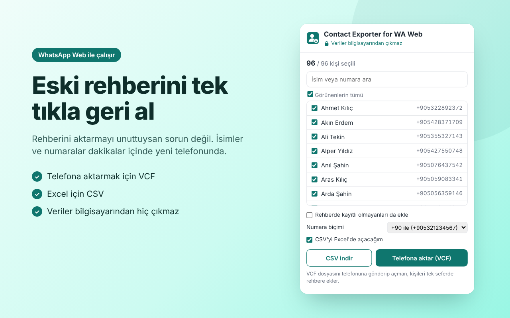

# Contact Exporter for WA Web

WhatsApp Web'de rehberinde kayıtlı görünen kişileri tek tıkla **VCF** (telefona aktarma) ve **CSV** (Excel) olarak dışa aktaran Chrome eklentisi. Telefonunu değiştirip rehberini aktarmayı unuttuysan, WhatsApp Web kişilerini hâlâ isimleriyle gösteriyorsa onları geri alabilirsin.



> **English:** A Chrome extension that exports the saved contacts visible in WhatsApp Web to VCF and CSV. Everything runs locally: no servers, no analytics, no network requests. The UI is currently Turkish only.

## Neden güvenilir?

- **Veriler bilgisayarından çıkmaz.** Kodda ağ isteği yapan tek bir satır yok. Kendin kontrol edebilirsin: tüm mantık [`extension/lib.js`](extension/lib.js) dosyasında.
- **Sadece iki izin:** `activeTab` (yalnızca simgesine tıkladığın sekmede, o an için) ve `scripting`. Tarama geçmişine ya da başka sitelere erişimi yok.
- **Salt okunur.** WhatsApp'a hiçbir şey yazmaz, mesaj göndermez, sohbetleri okumaz. Yalnızca WhatsApp Web'in tarayıcıda tuttuğu kişi listesinden isim ve numarayı alır.

## Kurulum

**Chrome Web Store:** _(bağlantı yayınlanınca eklenecek)_

**Geliştirici modu:**
1. Bu repoyu indir (Code → Download ZIP) ve bir klasöre aç.
2. Chrome'da `chrome://extensions` adresine git, sağ üstten **Geliştirici modu**nu aç.
3. **Paketlenmemiş öğe yükle** → `extension` klasörünü seç.

## Kullanım

1. web.whatsapp.com'u aç, sohbetlerin yüklenmesini bekle.
2. Eklenti simgesine tıkla.
3. İstemediğin kişilerin işaretini kaldır, arama kutusuyla filtrele.
4. **Telefona aktar (VCF):** dosyayı telefonuna gönderip aç, kişiler rehbere eklenir (Android ve iPhone).
   **CSV indir:** Excel'de açmak için. Google Kişiler'e aktaracaksan "CSV'yi Excel'de açacağım" seçeneğini kapat.

| Seçenek | Ne yapar |
|---|---|
| Rehberde kayıtlı olmayanları da ekle | Kaydetmediğin numaraları kişinin kendi profil adıyla ekler |
| Numara biçimi | `+905321234567` ya da `0532 123 45 67` (yalnızca CSV; VCF her zaman uluslararası biçimdedir) |
| CSV'yi Excel'de açacağım | Türkçe Excel için `;` ayırıcı kullanır, numaraların bilimsel gösterime (9,05E+11) dönmesini engeller |

## Bilinen sınırlar

- WhatsApp Web'in iç veri yapısı resmî bir arayüz değil, WhatsApp onu değiştirebilir. Okuma başarısız olursa eklenti "Teknik ayrıntı" bölümünde alan adlarını gösterir. Bunu bir [issue](../../issues) olarak paylaşırsan düzeltilebilir.
- Her kişi için WhatsApp'taki tek numara alınır. E-posta, ikinci numara, adres gibi bilgiler WhatsApp'ta olmadığı için gelmez.
- "Excel'de açacağım" modu Türkçe/Avrupa bölge ayarlı Excel'e göredir. İngilizce Excel'de bu seçeneği kapat.

## Geliştirme

```
extension/      Eklentinin kendisi (Manifest V3). Mağazaya giden zip bu klasörden üretilir.
  lib.js        Veri okuma (extractContacts), tekilleştirme, CSV/VCF üretimi
  popup.*       Arayüz
test/           lib.js için birim testleri (node:test)
scripts/        Sürüm kontrolü ve zip üretimi
store-assets/   Chrome Web Store görselleri
docs/           Mağaza metinleri ve yayınlama notları
```

```sh
npm test          # testleri çalıştırır (Node 20+, bağımlılık yok)
npm run package   # dist/ altına mağaza zip'ini üretir (Windows)
```

Yeni sürüm: `extension/manifest.json` ve `package.json` içindeki sürümü birlikte artır, [CHANGELOG.md](CHANGELOG.md)'ye not düş, `vX.Y.Z` etiketi at. GitHub Actions testleri çalıştırır ve zip'i Release'e ekler.

## Gizlilik

[PRIVACY.md](PRIVACY.md)

## Lisans

[MIT](LICENSE). Bu proje WhatsApp LLC veya Meta Platforms ile bağlantılı değildir.
